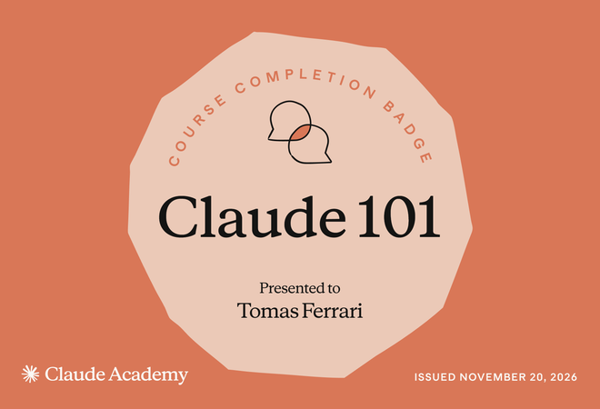
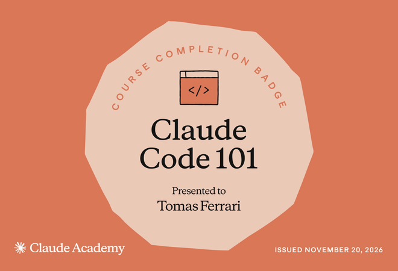
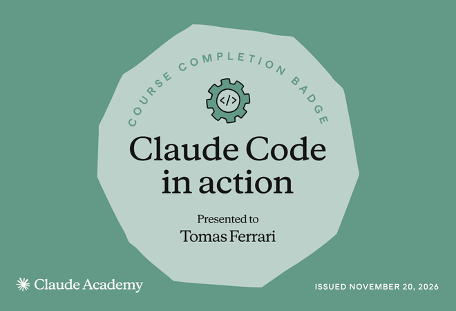
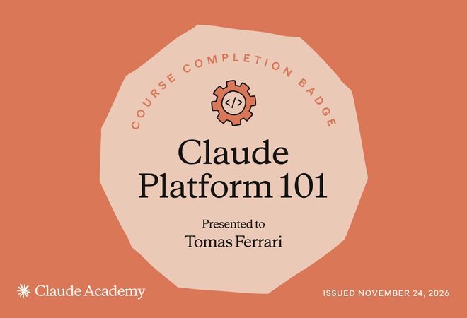
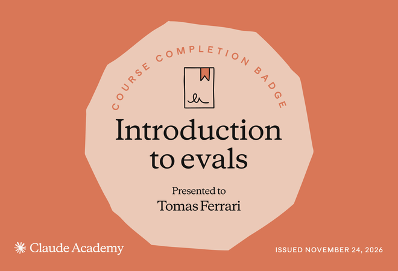
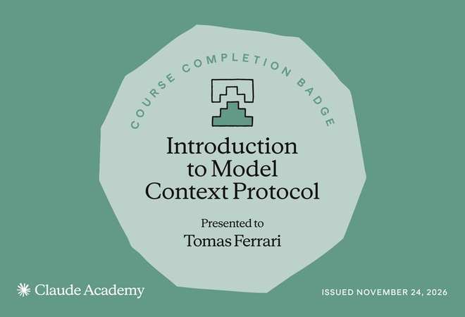

<p align="center">
  
</p>

<p align="center">
  <a href="https://github.com/FTInform">
    
  </a>
</p>

<p align="center">
  <a href="https://orbitarh.com.ar/login"></a>
  <a href="#-certificaciones"></a>
  <a href="https://agdress.netlify.app"></a>
</p>

---

## 🧪 Bitácora

```yaml
nombre:     Tomás Ferrari
base:       Gualeguaychú, Entre Ríos 🇦🇷
rol:        Desarrollador full-stack — sistemas de salud y plataformas SaaS
trayecto:   ~8 años en infraestructura IT → desarrollo de software
estudio:    Instituto Sedes Sapientiae
foco:       APIs .NET, bases de datos en producción, modernización de legacy, IA aplicada
```

Vengo del lado del hardware, los servidores y el soporte. Por eso cuando escribo software pienso también en dónde va a correr, quién lo va a mantener y qué pasa cuando algo falla: despliegues automatizados, respaldos, migraciones de esquema sin perder datos y documentación que explica el porqué.

### 🔭 Ahora mismo

- 🚀 Escalando **OrbitaRH**, una plataforma de RRHH multiempresa que ya está en producción.
- 🏥 Migrando un sistema de gestión de salud de **VB6 a .NET 10**, pantalla por pantalla y con pruebas de paridad contra Oracle.
- 🤖 Trabajando con **Claude Code**, el **Agent SDK** y **MCP** en el día a día y en herramientas propias.
- 🔬 Publicando experimentos de hardware y software en mis repos públicos.

---

## 🚀 Destacado: OrbitaRH

<table>
<tr>
<td width="62%" valign="top">

**Plataforma SaaS de Recursos Humanos, multiempresa y en producción.**

Cada empresa gestiona a su gente desde un solo lugar, con un panel de operador para dar de alta y administrar empresas.

- 📁 Legajos de empleados con validaciones reales (CUIL, CBU, alias, banco).
- 💸 Liquidaciones por empleado y por período, con recibos en PDF.
- 📣 Comunicaciones internas con fecha y hora.
- 🏢 Multiempresa: datos aislados por cliente y panel de superadministrador.
- 📊 Métricas de uso para decidir hacia dónde crece el producto.
- 🔐 JWT, contraseñas con BCrypt, migraciones de esquema versionadas y despliegue con Docker.

<a href="https://orbitarh.com.ar/login"></a>

</td>
<td width="38%" valign="top">

**Backend**<br>


**Frontend**<br>


**Datos e infraestructura**<br>


</td>
</tr>
</table>

---

## 🏗️ Trabajo profesional

Sistemas que construyo y mantengo en repositorios privados. Por confidencialidad muestro qué hacen y cómo están hechos, sin datos de clientes.

| | Sistema | Qué hace | Stack |
|:-:|---|---|---|
| 🏥 | **Sistema de guardia e internación** | Backend y frontend web para el circuito de guardia, enfermería, medicación e internación de un sanatorio. Convive con el sistema legacy y respeta sus reglas sobre la misma base. Incluye app móvil y despliegue automatizado. | .NET 8 · Oracle · Dapper · .NET MAUI · GitHub Actions |
| 🔁 | **Modernización de un sistema de salud** | Reescritura de un sistema VB6 + Oracle a .NET 10 con herramientas propias: conversor de formularios, inventario del código legacy y pruebas de paridad que comparan resultados contra un clon de la base. | .NET 10 · WinForms · Oracle · VB6 |
| 🧾 | **Envío de facturas por mail** | Servicio que genera la factura en PDF (con QR y código de barras) y la envía por correo, con pantalla de seguimiento. | .NET · Oracle · PDF |
| 📒 | **Gestión contable** | Carga, análisis y gráficos de la facturación mensual por cuenta, con roles y arquitectura lista para sumar módulos. | .NET 8 · Clean Architecture · EF Core · SQLite · Chart.js |
| 💬 | **Distribuidor de facturas por WhatsApp** | Contactos, plantillas de mensajes y envío masivo de facturas por WhatsApp Business API y email. | ASP.NET Core 8 · PostgreSQL · React · TypeScript · Tailwind |
| 📋 | **Tablero del equipo de desarrollo** | Tablero de tareas interno con despliegue automático al servidor. | ASP.NET Core 8 · React · TypeScript |
| 🤖 | **Viernes** | Asistente personal que conversa con memoria propia y orquesta Claude Code sobre mis proyectos. Accesible desde el celular por una red privada. | Claude Agent SDK · Fastify · WebSocket · React · Tailscale |

---

## 🧫 Proyectos públicos

| | Proyecto | Qué hace | Stack | |
|:-:|---|---|---|:-:|
| ♟️ | [**Chess AI**](https://agdress.netlify.app) | Ajedrez en el navegador con un bot de varios niveles. Sin servidor. | JavaScript · Minimax | [▶ Jugar](https://agdress.netlify.app) |
| 📘 | [**VETA**](https://github.com/FTInform/VETA) | Curso, 255 preguntas de práctica, simulacro de parcial y 97 tarjetas para Análisis y Diseño de Sistemas II (BI, minería de datos, CRISP-DM, redes de Petri). | HTML · CSS · JS, sin dependencias | [▶ Abrir](https://veta-mu.vercel.app) |
| 🔴 | [**Testigos**](https://github.com/FTInform/testigos-petri) | Curso y juego para aprender redes de Petri: 30 lecciones, árbol de alcanzabilidad, máquina de testigos, método matricial y simulacros corregidos. | HTML · CSS · JS, sin dependencias | [▶ Abrir](https://testigos-petri-testigos-petri.vercel.app) |

### ⏳ Próximamente

| | Proyecto | Qué va a ser | Stack |
|:-:|---|---|---|
| 🧠 | **Basic Decision Brain** | Redes neuronales desde cero, sin frameworks: backprop, Adam, self-attention y un modelo de lenguaje a nivel carácter. | Python · numpy |
| 🔌 | **NET GRID** | Puzzle de rotar cables para conectar la red, con lógica de grafos. | JavaScript |
| 📚 | **LangVerse** | Enciclopedia interactiva de lenguajes de programación. | React |
| 🌐 | **Portfolio** | Sitio personal con animaciones, desplegado en el edge. | Astro · React · GSAP |
| 🔧 | **MecanicOS** | Gestión de taller mecánico, del análisis (UML/DFD) a la implementación. | Académico |

---

## 🎓 Certificaciones

**Claude Academy** · cursos oficiales de Anthropic. Cada insignia enlaza a su verificación.

<table>
<tr>
<td align="center" width="33%">
<a href="https://academy.claude.com/verify/49aa26286a72694aba64ff78a3898de7"></a><br>
<b>Claude 101</b><br><sub>20 nov 2026</sub>
</td>
<td align="center" width="33%">
<a href="https://academy.claude.com/verify/b863db911481eb0db82aa1d39cb61e12"></a><br>
<b>Claude Code 101</b><br><sub>20 nov 2026</sub>
</td>
<td align="center" width="33%">
<a href="https://academy.claude.com/verify/96e6f858e2153e1b14c4bc85af9bb0b8"></a><br>
<b>Claude Code in Action</b><br><sub>20 nov 2026</sub>
</td>
</tr>
<tr>
<td align="center" width="33%">
<a href="https://academy.claude.com/verify/63211b77b727c00e771f2cfe7dfdabc4"></a><br>
<b>Claude Platform 101</b><br><sub>24 nov 2026</sub>
</td>
<td align="center" width="33%">
<a href="https://academy.claude.com/verify/d90e59fc183f70212af208b0f198cc87"></a><br>
<b>Introduction to Evals</b><br><sub>24 nov 2026</sub>
</td>
<td align="center" width="33%">
<a href="https://academy.claude.com/verify/75591da555c465e36cfdeddc456dc035"></a><br>
<b>Introduction to MCP</b><br><sub>24 nov 2026</sub>
</td>
</tr>
</table>

---

## ⚗️ Instrumental

**Lenguajes y frameworks**

<p>
  
</p>

**Datos, infraestructura y herramientas**

<p>
  
</p>

<p>
  
  
  
  
  
  
  
  
</p>

**IA y automatización**

<p>
  
  
  
  
  
  
</p>

---

## 📈 Lecturas del laboratorio

<p align="center">
  
</p>

<p align="center">
  
</p>

<p align="center">
  <picture>
    <source media="(prefers-color-scheme: dark)" srcset="https://raw.githubusercontent.com/FTInform/FTInform/output/snake-dark.svg" />
    <source media="(prefers-color-scheme: light)" srcset="https://raw.githubusercontent.com/FTInform/FTInform/output/snake-light.svg" />
    
  </picture>
</p>

---

<details>
<summary>🇬🇧 <b>English</b></summary>
<br>

I'm **Tomás**, a full-stack .NET developer from Argentina. I build **ASP.NET Core** APIs and **React + TypeScript** frontends on top of **Oracle**, **PostgreSQL** and **SQL Server**, mostly for healthcare systems and SaaS products.

- 🚀 **OrbitaRH**: a multi-tenant HR platform in production (employee records, payroll per employee with PDF payslips, internal communications, operator dashboard).
- 🏥 Hospital ER and inpatient system with a web frontend, a .NET MAUI mobile app and automated deployments.
- 🔁 Migrating a VB6 + Oracle healthcare system to .NET 10 with custom conversion tools and parity tests.
- 🤖 Daily work with **Claude Code**, the **Agent SDK** and **MCP**; six Claude Academy badges.

Before writing software I spent ~8 years in IT infrastructure and support. That background shapes how I build: with operations, maintenance and failure modes in mind.

My public repos are where I publish hardware and software experiments.

</details>

<p align="center">
  
</p>
